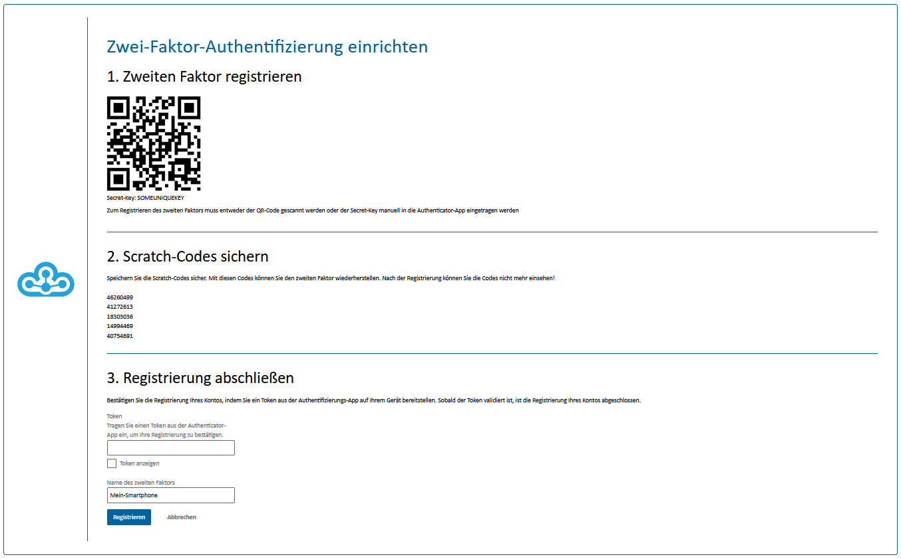
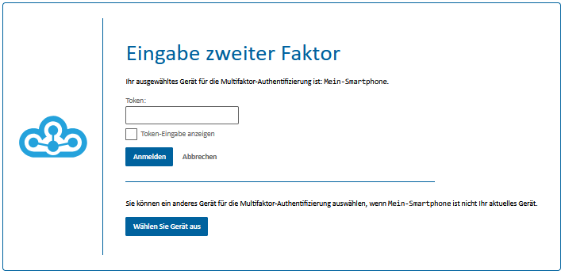
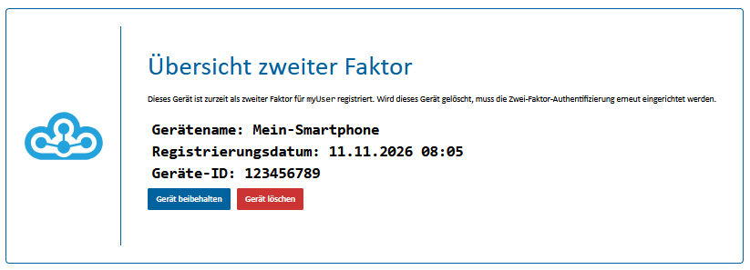
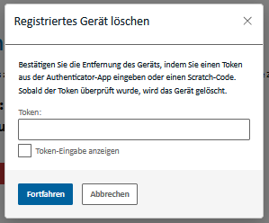

# Zwei-Faktor-Authentifizierung verwenden

Die Zwei-Faktor-Authentifizierung schützt Ihr Konto durch einen zusätzlichen Anmeldeschritt: Nach Ihrem Nutzernamen und Passwort geben Sie einen Code aus Ihrem Authenticator ein. In der Anmeldemaske wird dieser Code auch **Token** genannt.

Diese Anleitung gilt, wenn die Zwei-Faktor-Authentifizierung für Ihre Umgebung aktiviert ist. Beim ersten Anmelden werden Sie aufgefordert, Ihren zweiten Faktor einzurichten.

## Was Sie benötigen

Sie benötigen Ihre Zugangsdaten und einen Authenticator. Das kann eine Authenticator-App auf Ihrem Smartphone oder ein eigenes Gerät sein, das zeitbasierte Einmalcodes (TOTP) unterstützt. Ein solches Gerät wird auch Hardware-Authenticator genannt. Es muss sich mit einem QR-Code oder einem Einrichtungsschlüssel einrichten lassen. Ein Sicherheitsschlüssel, den Sie lediglich einstecken oder berühren, genügt für diesen Anmeldeablauf nicht.

Halten Sie Ihren Authenticator während der Einrichtung bereit. Planen Sie außerdem einen sicheren Ablageort für Ihre Scratch-Codes ein, auf den Sie auch ohne Ihr Authenticator-Gerät zugreifen können.

## Authenticator erstmals koppeln

### 1. Einrichtung öffnen

1. Öffnen Sie die gewünschte Anwendung im Cloudogu EcoSystem.
2. Melden Sie sich mit Ihrem Nutzernamen und Passwort an.
3. Folgen Sie gegebenenfalls der Aufforderung zur Registrierung, bis die Seite **„Zwei-Faktor-Authentifizierung einrichten“** erscheint.

### 2. App oder eigenes Gerät verbinden

**Mit einer Authenticator-App:**

1. Öffnen Sie Ihre Authenticator-App.
2. Wählen Sie die Funktion zum Hinzufügen eines Kontos, häufig über ein Pluszeichen oder „Konto hinzufügen“.
3. Wählen Sie das Scannen eines QR-Codes und scannen Sie den QR-Code auf der Einrichtungsseite.
4. Prüfen Sie, ob die App einen neuen Eintrag mit einem regelmäßig wechselnden Zahlencode anzeigt.

Wenn Sie den QR-Code nicht scannen können, wählen Sie in der App die manuelle Eingabe eines Einrichtungsschlüssels. Übertragen Sie den auf der Einrichtungsseite angezeigten **„Secret-Key“**. Wählen Sie einen zeitbasierten Code (TOTP), falls die App danach fragt. Das ist beispielsweise hilfreich, wenn Sie die Einrichtungsseite auf demselben Smartphone geöffnet haben.

**Mit einem eigenen Authenticator-Gerät:**

1. Öffnen Sie nach der Anleitung Ihres Geräts die Funktion zum Hinzufügen eines Kontos.
2. Übernehmen Sie den QR-Code oder den **„Secret-Key“** von der Einrichtungsseite mit dem vom Gerät vorgesehenen Verfahren. Manche Geräte benötigen dafür eine zugehörige App oder Verwaltungssoftware.
3. Prüfen Sie, ob Ihr Gerät anschließend einen aktuellen Zahlencode für dieses Konto anzeigt.

Wenn sich Ihr Gerät nicht auf diese Weise einrichten lässt, wenden Sie sich an Ihre Administration, um ein geeignetes Gerät zu klären.

Behandeln Sie den QR-Code und den Secret-Key vertraulich. Geben Sie diese nicht an andere Personen weiter.

### 3. Scratch-Codes sichern

Scratch-Codes sind **einmal verwendbare Ersatzcodes für Ihren zweiten Faktor**. Sie helfen Ihnen bei der Anmeldung, wenn Ihr Smartphone oder Authenticator-Gerät verloren, defekt oder gerade nicht verfügbar ist. Ihr Passwort benötigen Sie weiterhin.

Die Scratch-Codes werden auf der Einrichtungsseite unter **„2. Scratch-Codes sichern“** angezeigt. **Nach Abschluss der Registrierung können Sie diese Codes nicht mehr einsehen.**

1. Sichern Sie alle angezeigten Scratch-Codes, bevor Sie die Registrierung abschließen, beispielsweise als Ausdruck an einem geschützten Ort oder in einem Passwortmanager.
2. Stellen Sie sicher, dass Sie auf die Sicherung auch dann zugreifen können, wenn Ihr Authenticator-Gerät nicht verfügbar ist.
3. Geben Sie die Codes nicht weiter. Kennzeichnen oder entfernen Sie einen Code nach seiner Verwendung, damit Sie ihn nicht versehentlich erneut benutzen.

### 4. Registrierung abschließen

1. Öffnen Sie den neu angelegten Eintrag in Ihrer Authenticator-App oder auf Ihrem Gerät.
2. Tragen Sie den aktuell angezeigten Code im Abschnitt **„3. Registrierung abschließen“** in das Feld **„Token“** ein.
3. Geben Sie unter **„Name des zweiten Faktors“** einen Namen ein, an dem Sie Ihren Authenticator wiedererkennen, zum Beispiel „Mein Smartphone“.
4. Prüfen Sie noch einmal, ob Sie Ihre Scratch-Codes gesichert haben.
5. Klicken Sie auf **„Registrieren“**.

Mit der erfolgreichen Registrierung ist Ihr Authenticator mit Ihrem Konto gekoppelt. Bewahren Sie den zugehörigen Eintrag in Ihrer App beziehungsweise auf Ihrem Gerät auf: Sie benötigen ihn bei künftigen Anmeldungen.

## Mit dem zweiten Faktor anmelden

1. Melden Sie sich wie gewohnt mit Ihrem Nutzernamen und Passwort an.
2. Auf der Seite **„Eingabe zweiter Faktor“** öffnen Sie den passenden Kontoeintrag in Ihrer Authenticator-App oder auf Ihrem Gerät.
3. Geben Sie den aktuellen Code in das Feld **„Token“** ein. Übernehmen Sie alle Ziffern, auch eine führende Null.
4. Bestätigen Sie die Anmeldung über die Anmeldeschaltfläche.

Falls eine Geräteübersicht erscheint, wählen Sie Ihren registrierten Authenticator über **„Gerät beibehalten“** aus. Achten Sie auf den von Ihnen vergebenen Gerätenamen.

Die Codes wechseln regelmäßig. Steht ein Wechsel unmittelbar bevor, warten Sie auf den nächsten Code und geben Sie diesen ein. Wenn Sie im Cloudogu EcoSystem bereits angemeldet sind, kann eine weitere Anwendung ohne erneute Code-Abfrage geöffnet werden.

## Ohne Authenticator mit einem Scratch-Code anmelden

1. Geben Sie auf der Anmeldeseite Ihren Nutzernamen und Ihr Passwort ein.
2. Tragen Sie auf der Seite **„Eingabe zweiter Faktor“** einen noch unbenutzten Scratch-Code in dasselbe Feld ein, in das Sie sonst den Code Ihres Authenticators eingeben.
3. Bestätigen Sie die Anmeldung.
4. Kennzeichnen oder entfernen Sie den verwendeten Scratch-Code in Ihrer Sicherung. Er kann nicht erneut verwendet werden.

Ein Scratch-Code ersetzt den Authenticator-Code für diese Anmeldung. Er koppelt nicht automatisch ein neues Gerät. Wenn Sie Ihren Authenticator dauerhaft verloren haben, kümmern Sie sich anschließend um die Einrichtung eines Ersatzes.

## Gerät wechseln oder verloren

Wenn die Geräteübersicht angeboten wird, können Sie dort die Registrierung des bisherigen Authenticators entfernen. Die Entfernung müssen Sie mit einem aktuellen Code dieses Authenticators oder einem unbenutzten Scratch-Code bestätigen. Im Bestätigungsdialog **„Registriertes Gerät löschen“** schließen Sie den Vorgang mit **„Fortfahren“** ab. Anschließend muss der zweite Faktor erneut eingerichtet werden. Sichern Sie dabei auch die neu angezeigten Scratch-Codes.

Löschen Sie bei einem geplanten Wechsel den alten Eintrag in Ihrer Authenticator-App erst, wenn Sie ihn für die Bestätigung nicht mehr benötigen.

Wenn Sie weder einen gültigen Authenticator-Code noch einen unbenutzten Scratch-Code haben oder die Geräteverwaltung nicht erreichen, wenden Sie sich an Ihre Administration. Das gilt auch, wenn Ihr Gerät gestohlen wurde und Sie Unterstützung beim Absichern Ihres Kontos benötigen.

## Häufige Probleme

- **Der Code wird abgelehnt:** Prüfen Sie, ob Sie den richtigen Kontoeintrag und gegebenenfalls das richtige registrierte Gerät ausgewählt haben. Warten Sie auf einen neuen Code und geben Sie ihn vollständig ein.
- **Auch neue Codes funktionieren nicht:** Prüfen Sie Datum und Uhrzeit Ihres Authenticator-Geräts. Aktivieren Sie, falls möglich, die automatische Zeiteinstellung und versuchen Sie es erneut.
- **Die Einrichtung lässt sich nicht bestätigen:** Verwenden Sie den Code aus dem gerade neu angelegten Authenticator-Eintrag. In das Feld „Token“ gehört der aktuelle Zahlencode, nicht der Secret-Key.
- **Ein Scratch-Code funktioniert nicht:** Prüfen Sie die Eingabe und verwenden Sie einen noch unbenutzten Code aus der Sicherung des ausgewählten Authenticators.
- **Das Problem bleibt bestehen:** Wenden Sie sich an Ihre Administration. Geben Sie dabei weder Ihr Passwort noch den Secret-Key oder Ihre Scratch-Codes weiter.
