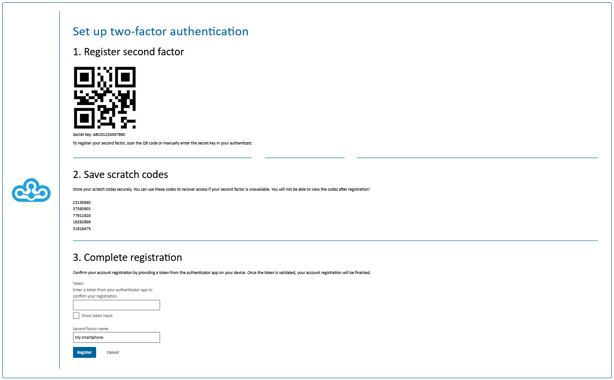
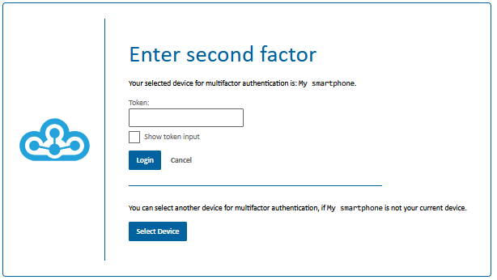
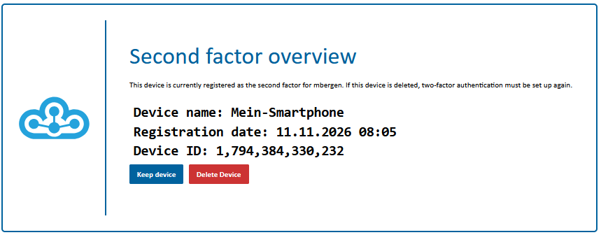
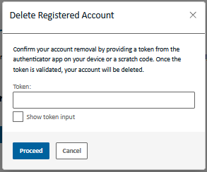

# Using two-factor authentication

Two-factor authentication protects your account with an additional login step: after entering your username and password, you enter a code from your authenticator. On the login screen, this code is also called a **token**.

This guide applies when two-factor authentication is enabled for your environment. The first time you log in, you will be prompted to set up your second factor.

## What you need

You need your login credentials and an authenticator. This can be an authenticator app on your smartphone or a dedicated device that supports time-based one-time passwords (TOTP). Such a device is also called a hardware authenticator. It must support setup using a QR code or a setup key. A security key that you simply plug in or touch is not sufficient for this login process.

Have your authenticator ready during setup. Also choose a secure place to store your scratch codes that you can access even without your authenticator device.

## Pairing your authenticator for the first time

### 1. Open the setup page

1. Open the application you want to use in the Cloudogu EcoSystem.
2. Log in with your username and password.
3. If prompted to register, follow the instructions until the **“Set up two-factor authentication”** page appears.

### 2. Connect an app or a dedicated device

**Using an authenticator app:**

1. Open your authenticator app.
2. Select the option to add an account, often shown as a plus sign or “Add account”.
3. Select the option to scan a QR code and scan the QR code on the setup page.
4. Check that the app displays a new entry with a numeric code that changes regularly.

If you cannot scan the QR code, select the option in the app to enter a setup key manually. Enter the **“Secret-Key”** displayed on the setup page. Select a time-based code (TOTP) if the app asks. This is useful, for example, if you have opened the setup page on the same smartphone.

**Using a dedicated authenticator device:**

1. Follow your device's instructions to open the option for adding an account.
2. Transfer the QR code or **“Secret-Key”** from the setup page using the method provided by your device. Some devices require a companion app or management software for this.
3. Check that your device now displays a current numeric code for this account.

If your device cannot be set up this way, contact your administrator to find a suitable device.

Keep the QR code and the Secret-Key confidential. Do not share them with anyone else.

### 3. Save your scratch codes

Scratch codes are **single-use backup codes for your second factor**. They help you log in if your smartphone or authenticator device is lost, broken, or temporarily unavailable. You still need your password.

The scratch codes are displayed on the setup page under **“2. Save scratch codes”**. **Once registration is complete, you can no longer view these codes.**

1. Save all the scratch codes displayed before completing registration, for example as a printout kept in a secure place or in a password manager.
2. Make sure you can access the backup even if your authenticator device is unavailable.
3. Do not share the codes. Mark or remove a code after using it so that you do not accidentally try to use it again.

### 4. Complete registration

1. Open the newly created entry in your authenticator app or on your device.
2. Enter the currently displayed code in the **“Token”** field in the **“3. Complete registration”** section.
3. Under **“Name of the second factor”**, enter a name that helps you recognize your authenticator, for example “My smartphone”.
4. Check again that you have saved your scratch codes.
5. Click **“Register”**.

Once registration is successful, your authenticator is paired with your account. Keep the corresponding entry in your app or on your device: you will need it for future logins.

## Logging in with the second factor

1. Log in with your username and password as usual.
2. On the **“Enter second factor”** page, open the matching account entry in your authenticator app or on your device.
3. Enter the current code in the **“Token”** field. Include all digits, including any leading zero.
4. Confirm the login using the login button.

If a device overview appears, select your registered authenticator using **“Keep device”**. Look for the device name you assigned.

The codes change regularly. If a code is about to change, wait for the next code and enter that one. If you are already logged in to the Cloudogu EcoSystem, you may be able to open another application without being prompted for a code again.

## Logging in with a scratch code without your authenticator

1. Enter your username and password on the login page.
2. On the **“Enter second factor”** page, enter an unused scratch code in the same field where you would normally enter your authenticator code.
3. Confirm the login.
4. Mark or remove the scratch code you used in your backup. It cannot be used again.

A scratch code replaces the authenticator code for this login. It does not automatically pair a new device. If you have permanently lost your authenticator, arrange to set up a replacement afterwards.

## Replacing a device or dealing with a lost device

If the device overview is available, you can remove the registration of your previous authenticator there. You must confirm the removal with a current code from that authenticator or an unused scratch code. In the **“Delete registered device”** confirmation dialog, complete the process by clicking **“Continue”**. You must then set up the second factor again. Be sure to save the newly displayed scratch codes as well.

When planning to switch devices, only delete the old entry in your authenticator app once you no longer need it for confirmation.

If you have neither a valid authenticator code nor an unused scratch code, or if you cannot access device management, contact your administrator. This also applies if your device has been stolen and you need help securing your account.

## Common problems

- **The code is rejected:** Check that you have selected the correct account entry and, if applicable, the correct registered device. Wait for a new code and enter it in full.
- **New codes do not work either:** Check the date and time on your authenticator device. If possible, enable automatic time settings and try again.
- **You cannot confirm setup:** Use the code from the authenticator entry you have just created. The “Token” field requires the current numeric code, not the Secret-Key.
- **A scratch code does not work:** Check your input and use an unused code from the backup for the selected authenticator.
- **The problem persists:** Contact your administrator. Do not share your password, Secret-Key, or scratch codes when doing so.
